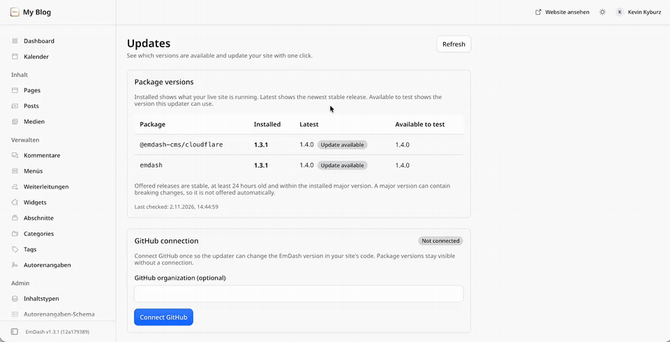
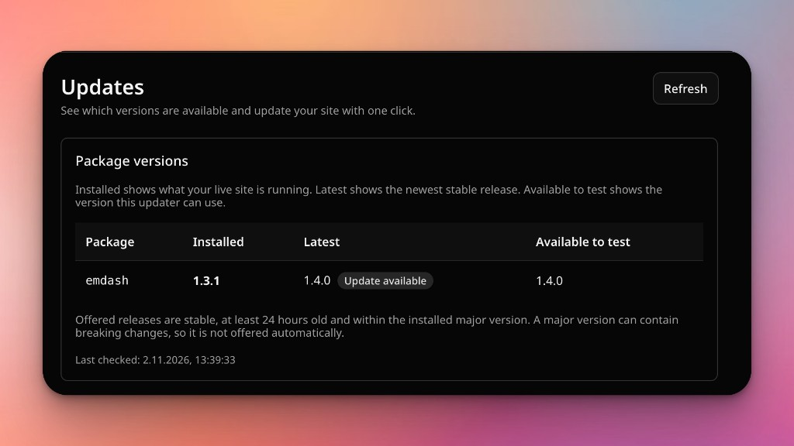
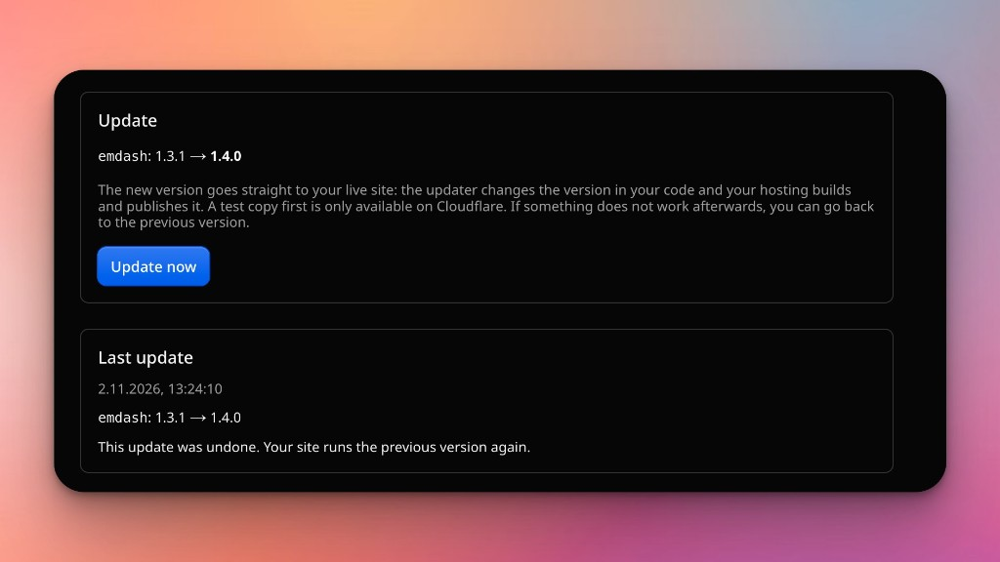

# EmDash Updater

Update [EmDash](https://emdashcms.com) from the admin with one click. The plugin commits the new versions to your GitHub repository, waits until your hosting has deployed them, and lets you undo the update.

[](https://github.com/swissky/emdash-updater/blob/main/docs/demo.mp4)

[Watch the full video](https://github.com/swissky/emdash-updater/blob/main/docs/demo.mp4)


## What it does

- Shows which EmDash packages are installed and which newer versions are out.
- **Update now** writes the new versions to `package.json` (and your lockfile) on your live branch. Your hosting builds and deploys as usual; database migrations run on the first request.
- Offers a database backup download before the update starts.
- Watches the build your hosting reports to GitHub. If it fails, the plugin shows the failure and puts the previous versions back when you click **Discard**.
- **Undo update** returns to the versions you had before, in one click.
- On Cloudflare Workers with D1, every update can first run as a **test version** with a copy of your content. You open it, check it, and only then apply it to the live site.





## Requirements

- EmDash 1.3 or later, Node.js 22.13 or later.
- The site's code lives in a **GitHub** repository.
- Your hosting deploys automatically when that repository changes (Cloudflare Workers Builds, Render, Vercel, Netlify, Coolify, a GitHub Actions deploy, and similar).

## Install

```bash
npm install emdash-updater
```

Add the integration and the plugin in `astro.config.mjs`:

```js
import { defineConfig } from "astro/config";
import emdash from "emdash/astro";
import updater from "emdash-updater/astro";
import { updaterPlugin } from "emdash-updater";

export default defineConfig({
	integrations: [
		updater(),
		emdash({
			// your database, storage, ...
			plugins: [updaterPlugin()],
		}),
	],
});
```

Keep `updater()` before `emdash()`. Commit, push, and let your hosting deploy.

### Only let some people update

By default every Admin can run updates. On a client site where you look after updates yourself, list the people who may:

```js
plugins: [updaterPlugin({ allowedUsers: ["you@agency.com"] })],
```

Other Admins still see the installed and available versions, with a note that you manage updates. Every update action refuses them with a 403. Leave the plugin out of `astro.config.mjs` if the Updates page should not appear at all.

### Cloudflare Workers: test versions

Test versions need Cloudflare Workers Builds connected to your GitHub repository, with builds for non-production branches turned on. Point `main` in `wrangler.jsonc` at a worker file that re-exports the plugin's worker:

```ts
// src/worker.ts
export { default, PluginBridge } from "emdash-updater/worker";
```

The plugin turns test versions on when it finds a `wrangler.jsonc`. To update straight to the live site instead, use `updater({ previews: false })`.

## Connect GitHub

1. Open **Admin > Plugins > Updates** and click **Connect GitHub**.
2. GitHub asks you to create a private GitHub App for your site. The app belongs to your account, not to anyone else. Its key is stored encrypted in the plugin settings.
3. Install the app on the repository your site is built from, then pick that repository in the admin.

The app asks for these permissions:

| Permission | Why |
| --- | --- |
| Contents: read and write | Commit the new versions and undo them |
| Workflows: read and write | Add the workflow that updates your lockfile |
| Checks, commit statuses, deployments: read | Read whether your hosting's build succeeded |

If you connected before the workflow permission existed, the Updates page shows an **Allow on GitHub** link. Accept the new permission there once.

## Lockfiles

When your repository has a `package-lock.json`, `pnpm-lock.yaml`, `yarn.lock` or `bun.lock`, the plugin does not touch your live branch right away. It pushes the update to the branch `emdash-update-lockfile`, where a small GitHub Actions workflow (`.github/workflows/emdash-updater-lockfile.yml`, added by the plugin) updates the lockfile. The plugin checks that the workflow changed only the lockfile, then moves your live branch forward to that commit. Your hosting builds once, with `package.json` and the lockfile in sync, so `npm ci` keeps working.

## Undo and your database

**Undo update** restores `package.json` and the lockfile to the previous versions. Database changes made by the newer version stay in place. EmDash migrations only add to the schema, and older versions keep working with a newer database. On Cloudflare with test versions, undo can also restore the D1 database to the moment before the update (D1 Time Travel, up to 7 days on the Free plan).

Undo still works when `main` got more commits after the update, as long as they left `package.json` and the lockfile as the update wrote them.

Download the backup offered before each update if you want a copy you control.

## Hosting

| Hosting | Mode |
| --- | --- |
| Cloudflare Workers Builds with D1 | Test version first, then apply |
| Render, Vercel, Netlify, Coolify | Straight to live |
| Docker on your own server | Straight to live, when a GitHub push triggers your deploy (for example a GitHub Actions workflow that rebuilds the container) |

The plugin reads the build result from GitHub check runs, commit statuses or deployments. If your hosting reports none, the plugin shows the update as waiting and gives you the way back after 15 minutes.

### Docker on your own server

The plugin never connects to your server. It commits to GitHub, and your deploy picks up the push. A small, safe setup:

1. Run the site with Docker Compose and keep the database and the sessions on a volume:

   ```yaml
   # compose.yaml
   services:
     site:
       build: .
       restart: unless-stopped
       env_file: .env
       ports:
         - "127.0.0.1:4321:4321"
       volumes:
         - data:/app/data
   volumes:
     data:
   ```

   ```js
   // astro.config.mjs
   import { defineConfig, sessionDrivers } from "astro/config";

   export default defineConfig({
   	session: { driver: sessionDrivers.fsLite({ base: "./data/sessions" }) },
   	// ...
   });
   ```

   Without a persistent session store, every rebuild of the container signs everyone out. The Updates page then sends you to the sign-in and back; the update status is kept. With several containers, use a shared store such as Redis instead.

2. Put a deploy script on the server that pulls `main` and rebuilds:

   ```sh
   #!/bin/sh
   # deploy/deploy.sh
   set -eu
   cd "$(dirname "$0")/.."
   git fetch --quiet origin main
   git reset --quiet --hard origin/main
   docker compose up -d --build --remove-orphans
   ```

3. Create an SSH key that can run only this script. Add its public key to `~/.ssh/authorized_keys` on the server:

   ```
   command="/path/to/site/deploy/deploy.sh",no-pty,no-port-forwarding,no-agent-forwarding,no-X11-forwarding ssh-ed25519 AAAA... deploy
   ```

4. Add a workflow that runs the script on every push to `main`. Store the private key, `user@host` and the output of `ssh-keyscan <host>` as the secrets `DEPLOY_SSH_KEY`, `DEPLOY_HOST` and `DEPLOY_KNOWN_HOSTS`:

   ```yaml
   # .github/workflows/deploy.yml
   name: Deploy
   on:
     push:
       branches: [main]
   concurrency: deploy
   jobs:
     deploy:
       runs-on: ubuntu-latest
       steps:
         - env:
             SSH_KEY: ${{ secrets.DEPLOY_SSH_KEY }}
             SSH_HOST: ${{ secrets.DEPLOY_HOST }}
             SSH_KNOWN_HOSTS: ${{ secrets.DEPLOY_KNOWN_HOSTS }}
           run: |
             mkdir -p ~/.ssh
             echo "$SSH_KEY" > ~/.ssh/id_ed25519
             echo "$SSH_KNOWN_HOSTS" > ~/.ssh/known_hosts
             chmod 600 ~/.ssh/id_ed25519
             ssh "$SSH_HOST" deploy
   ```

The workflow run is reported to GitHub as a check, so the Updates page shows when the new version is live.

## License

GPL-3.0-or-later. See [LICENSE](LICENSE).
